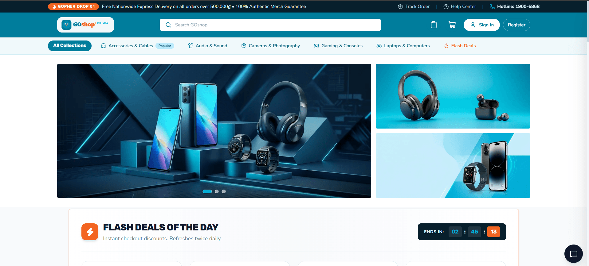
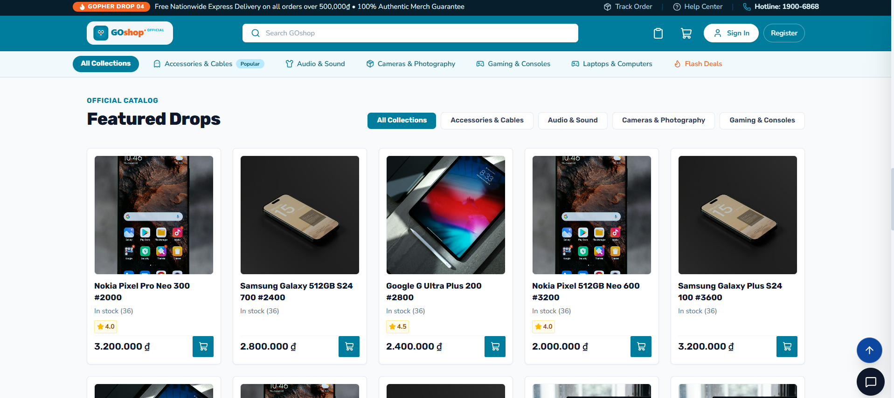
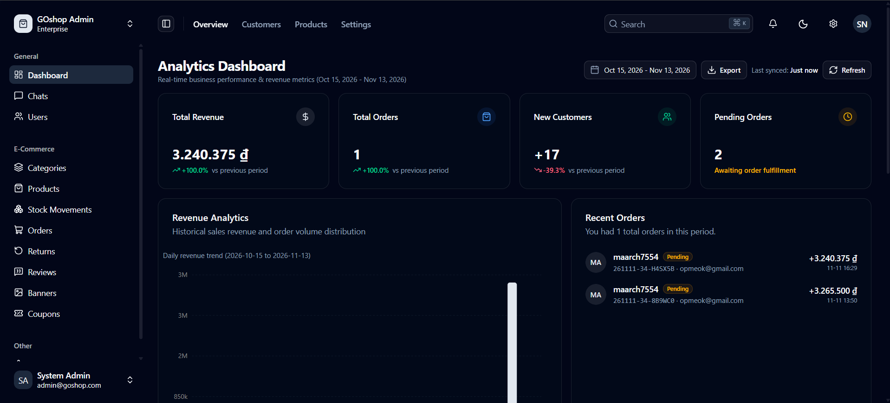
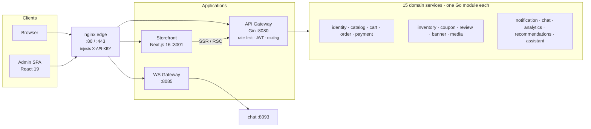
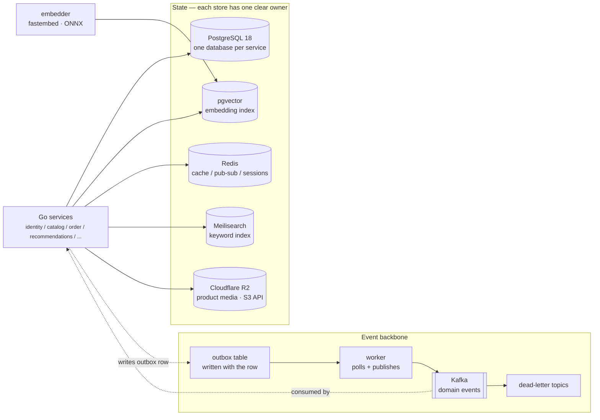

<div align="center">

# GOshop

**A production-shaped e-commerce platform, built in the open.**

Go microservices behind an API gateway · Next.js storefront · React admin dashboard
one edge proxy · one event bus · one PostgreSQL cluster per domain


</div>

---

## Preview

|                                                 Storefront home page                                                  |                                                                  Product catalogue                                                                  |                                                  Admin dashboard                                                  |
| :-------------------------------------------------------------------------------------------------------------------: | :-------------------------------------------------------------------------------------------------------------------------------------------------: | :---------------------------------------------------------------------------------------------------------------: |
| [](docs/img/storefront.png) | [](docs/img/storefront1.png) | [](docs/img/dashboard.png) |
|                                                 Next.js 16 storefront                                                 |                                                                Next.js 16 storefront                                                                |                                                React 19 admin SPA                                                 |

---

## What this is

A storefront that sells, an admin dashboard that runs it, and a backend that stays correct
under load. Everything below is wired and runnable — not a scaffold:

|                              |                                                                                                                                                   |
| ---------------------------- | ------------------------------------------------------------------------------------------------------------------------------------------------- |
| **15 Go services**           | one module, one schema, one migration set each                                                                                                    |
| **140 documented endpoints** | one OpenAPI spec, one generated TypeScript client                                                                                                 |
| **Transactional outbox**     | domain events committed with the row, never a dual write                                                                                          |
| **Hybrid search**            | keyword + pgvector embeddings, fused with reciprocal rank fusion                                                                                  |
| **Full observability**       | Prometheus, Grafana, Alertmanager, Promtail, k6 load tests                                                                                        |
| **Written down**             | [`docs/ARCHITECTURE.md`](docs/ARCHITECTURE.md) traces checkout end to end; ten [ADRs](docs/ADR/README.md) record why, including what was rejected |

Built to be run for real: load shedding, circuit breakers, structured logs, health probes,
graceful shutdown, and an integration suite that runs against a real broker rather than mocks.

---

## Table of contents

- [Preview](#preview)
- [What this is](#what-this-is)
- [Architecture](#architecture)
- [Repository Layout](#repository-layout)
- [Prerequisites](#prerequisites)
- [Environment setup](#environment-setup-one-time)
- [Running the stack](#running-the-stack)
- [Switching dev and prod](#switching-dev-and-prod)
- [Monitoring, tracing and logs](#monitoring-tracing-and-logs)
- [Demo accounts](#demo-accounts)
- [Scripts](#scripts)
- [API Documentation](#api-documentation)
- [Testing & CI](#testing-ci)
- [Troubleshooting](#troubleshooting)
- [Project status](#project-status)
- [License](#license)

---

## Tech Stack

### Backend


### Frontend


### Infra, Search & Observability


---

## Architecture

### Request path



### Data and events



---

## Repository Layout

```
backend/
  gomod/shared/           reusable packages (config, logger, telemetry, utils)
  gomod/contracts/        event payloads shared by services
  gomod/services/         one module per domain (identity, catalog, order, ...)
  gomod/cmd/              one binary per service
  build/Dockerfile.service  one image template, ARG SERVICE=<name>
frontend/
  apps/storefront/        Next.js 16 App Router
  apps/dashboard/         Vite + React 19 admin SPA
  packages/api-client/    generated OpenAPI client with silent refresh
nginx/                    edge config, API key templates, TLS
scripts/                  dev orchestration, secrets, smoke tests, load tests
system/                   Prometheus rules, Grafana, Alertmanager, Promtail, R2, Redis
design-system/goshop/     MASTER.md — tokens and layout rules the UI is built from
docker-compose.prod.yml   full stack (edge, gateway, 15 services, infra, observability)
docker-compose.dev.yml    containerised dev topology
docs/SERVICES.md          generated index: HTTP/gRPC ports, database, migrations per service
docs/ARCHITECTURE.md      checkout traced end to end, failure matrix, compensation flow
docs/ADR/                 ten accepted decisions with consequences and rejected alternatives
DEPLOY.md                 production deployment ADR (topology, secrets, rollback)
Makefile                  every workflow in this README
```

> Per-service detail: [`docs/SERVICES.md`](docs/SERVICES.md) is generated from compose and the
> migrations (`make services-doc`), so it cannot drift. Only `order` also has a hand-written
> [`README.md`](backend/gomod/services/order/README.md) covering ownership and failure modes.

---

## Prerequisites

| Tool           | Version | Notes                                                 |
| -------------- | ------- | ----------------------------------------------------- |
| Docker Desktop | 4.x+    | Linux containers; 8 GB RAM recommended                |
| Go             | 1.26+   | only needed for `make dev-host` / bare metal          |
| Node.js        | 22+     | storefront + dashboard                                |
| pnpm           | 11.x    | `corepack enable` is enough                           |
| GNU Make       | any     | Windows: `choco install make` or run commands by hand |
| PowerShell     | 7+      | the `.ps1` orchestration scripts target it            |

---

## Environment setup (one-time)

Real `.env` files are git-ignored; the repo ships **templates only**. Every service, every
compose command and every make target reads the literal path `backend/.env` — `make` fills it by
copying the variant you asked for.

| Template                                    | Active file                  | Written by                                                |
| ------------------------------------------- | ---------------------------- | --------------------------------------------------------- |
| `backend/.env.dev.example`                  | `backend/.env`               | `make env-dev` (auto-ran by `make dev` / `make dev-host`) |
| `backend/.env.prod.example`                 | `backend/.env`               | `make env-prod`                                           |
| `frontend/apps/storefront/.env.dev.example` | `apps/storefront/.env`       | `make env-dev`                                            |
| `frontend/apps/storefront/.env.dev-host`    | `apps/storefront/.env.local` | `make dev-host`                                           |

```powershell
corepack enable
cd frontend; pnpm install; cd ..

Copy-Item backend/.env.dev.example backend/.env.dev
Copy-Item frontend/apps/storefront/.env.dev.example frontend/apps/storefront/.env.dev

# API_KEY + INTERNAL_API_TOKEN -> nginx/secrets/ + backend/.env. Copy both values into backend/.env.dev.
powershell -ExecutionPolicy Bypass -File scripts/gen-local-secrets.ps1

# JWT RS256 key pair
openssl genpkey -algorithm RSA -out backend/certs/jwt_private.pem -pkeyopt rsa_keygen_bits:2048
openssl rsa -pubout -in backend/certs/jwt_private.pem -out backend/certs/jwt_public.pem
```

Then fill in whatever `CHANGE_ME` is left in `backend/.env.dev`:

| Variable                             | Value                                                  |
| ------------------------------------ | ------------------------------------------------------ |
| `API_KEY`                            | 32+ random chars; the edge injects it as `X-API-KEY`   |
| `INTERNAL_API_SECRET`                | another random string, service-to-service only         |
| `DB_PASSWORD`                        | password for the local `postgres` container            |
| `JWT_PRIVATE_KEY` / `JWT_PUBLIC_KEY` | paths to the RSA pair above                            |
| `APP_ORIGIN`                         | `http://localhost` — every browser URL derives from it |

The dashboard needs no env: `VITE_API_BASE_URL` and `VITE_API_KEY` stay empty (same-origin
behind the edge). Production is the same flow with `.env.prod` + `make kafka-env`.

---

## Running the stack

### Containerised dev

```powershell
make dev            # env-dev -> switch-stack dev -> up (API edge :80, storefront edge :3001)
make seed-docker    # first run only
make smoke-dev      # every gateway route must answer; a 502 fails the run
```

The storefront runs on the host so it hot-reloads. Second terminal, from `frontend/`:

```powershell
pnpm dev:storefront:edge    # next dev :3002 behind the edge -> http://localhost:3001
pnpm dev:dashboard          # dashboard -> http://localhost:5173
```

`pnpm dev:storefront:edge` refuses to start if the edge is not answering; bring it up once with
`docker compose -f docker-compose.dev.yml --env-file backend/.env up -d nginx`.

### Hybrid dev (fastest Go loop)

```powershell
make dev-host                      # infra in Docker, Go services on the host, gateway :8080
cd frontend; pnpm dev:storefront   # storefront -> http://localhost:3002
```

### Topology

| Goal                     | Command                            | Entry point                            |
| ------------------------ | ---------------------------------- | -------------------------------------- |
| Everything containerised | `make dev`                         | storefront `:3001`, API `:80`          |
| Host-side Go loop        | `make dev-host`                    | storefront `:3002`, gateway `:8080`    |
| Production-shaped        | `make prod`                        | `http://127.0.0.1/`, `:443`            |
| Stop                     | `make stop-dev` / `make stop-prod` | kills host binaries **and** containers |

Use `127.0.0.1`, not `localhost`, on Windows: `localhost` resolves to IPv6 first while Docker
publishes IPv4.

### Switching dev and prod

Both compose files declare the same `container_name`s and join the same network, so a bare
`docker compose up -d` from the other file leaves the previous stack running and mixes configs —
that is exactly how the 2026-11-17 Kafka outage happened. Always:

```powershell
make switch-stack STACK=dev     # or STACK=prod: tears the other stack down, rebuilds, checks drift
make check-drift                # add --dev for the dev stack
make smoke-dev                  # or make smoke-prod
```

`make dev` already runs `env-dev` + `switch-stack STACK=dev`. For prod the order matters —
`make env-prod` → `make kafka-env` (fresh volume: SASL users + TLS material) →
`make switch-stack STACK=prod`, otherwise the build bakes the dev `API_KEY`/`APP_ORIGIN` into the
storefront bundle.

### Local monitoring

Optional; the committed Grafana dashboard reads a local Prometheus:

```powershell
docker compose -f docker-compose.dev.yml --env-file backend/.env up -d grafana prometheus jaeger
```

| Surface                   | URL                                       |
| ------------------------- | ----------------------------------------- |
| Grafana "GOshop Overview" | `http://127.0.0.1:3000/d/goshop-overview` |
| Prometheus / Alertmanager | `:9090` / `:9093`                         |
| Jaeger (dev only)         | `:16686`                                  |

---

## Monitoring, tracing and logs

Three signals, one question each: **is it up** (metrics), **why was this request slow or
broken** (traces), **what exactly happened** (logs). The fourth question — _is a message stuck_ —
is answered by Kafka lag, which is a metric with an alert on it.

### 1. Metrics — Prometheus + the dashboard

Every service mounts `GET /metrics` on its own gin router (`shared/pkg/metrics`). Prometheus
discovers containers by name (`system/prometheus/prometheus.yml`), so nothing is registered by
hand. `kafka-exporter` adds broker-side metrics that no Go process can see:
`kafka_consumergroup_lag`, under-replicated partitions, throughput.

```powershell
# raw scrape targets and their state
start http://127.0.0.1:9090/targets

# a quick ad-hoc query
start "http://127.0.0.1:9090/graph?g0.expr=sum%20by%20(consumergroup)%20(kafka_consumergroup_lag)"
```

What the 6 dashboard panels tell you:

| Panel                      | Reads                                                           | Red flag                                                                       |
| -------------------------- | --------------------------------------------------------------- | ------------------------------------------------------------------------------ |
| Services Up / Down         | `up{job="goshop-services"}`                                     | Down > 0 for 2 min → `ServiceDown` (critical)                                  |
| Consumer Lag by Group      | `kafka_consumergroup_lag`                                       | > 1000 for 5 min → `ConsumerLagHigh`; flat and non-zero → `ConsumerLagStalled` |
| Publish OK vs Errors       | `kafka_publish_ok_total`, `kafka_publish_errors_total`          | > 0.2 errors/s for 10 min → `KafkaPublishFailing`                              |
| DLQ Moves                  | `kafka_dlq_total`                                               | Any rate → `KafkaDLQGrowing`, drain with `make check-dlq`                      |
| Records Missing `event_id` | `kafka_records_published_total` vs `..._missing_event_id_total` | > 1% → `EventsMissingEventID`; those records cannot be deduplicated            |

Per-service counters worth knowing: `kafka_publish_ok_total`, `kafka_publish_errors_total`,
`kafka_dlq_total`, `kafka_consume_errors_total`, `kafka_records_published_total`,
`kafka_records_missing_event_id_total`.

`/metrics` is **unauthenticated and internal only**. It is not published in prod and nginx does
not proxy it — do not add a rule for it.

Alert thresholds live in `system/prometheus/rules/goshop.yml`; `scripts/check_alert_rules.py`
fails CI if a rule references a metric nobody exposes. Discord delivery needs
`ALERTMANAGER_DISCORD_WEBHOOK_URL`; with it empty, dev starts with a silent config and alerts
fire but go nowhere.

### 2. Traces — Jaeger in dev, Grafana Cloud Tempo in prod

Tracing is **off unless an endpoint is configured** (`shared/pkg/telemetry`): with no
`OTEL_EXPORTER_OTLP_ENDPOINT` the provider is a no-op and the service still serves traffic.

- **Dev**: start the collector with the rest of the stack —
  `docker compose -f docker-compose.dev.yml --env-file backend/.env up -d jaeger`, then open
  `http://127.0.0.1:16686`, pick a service (`goshop-order`, `goshop-payment`, …), search.
- **Prod**: set `OTEL_EXPORTER_OTLP_ENDPOINT` + `OTEL_EXPORTER_OTLP_HEADERS` to a Grafana Cloud
  OTLP gateway; sampling is `OTEL_TRACES_SAMPLER_ARG` (`0.1` in the prod example).

> **`backend/.env` wins over the compose default.** Services are given
> `OTEL_EXPORTER_OTLP_ENDPOINT=${OTEL_EXPORTER_OTLP_ENDPOINT:-http://jaeger:4318}`, so a value in
> `backend/.env` overrides it. With the Grafana Cloud line in place, containers send spans to
> Tempo and `http://127.0.0.1:16686` stays empty. Check what a process actually got, and
> re-create it once after switching:
>
> ```powershell
> docker exec goshop-order printenv OTEL_EXPORTER_OTLP_ENDPOINT
> docker compose -f docker-compose.dev.yml --env-file backend/.env up -d --force-recreate order payment
> ```

A trace spans HTTP → gRPC → Kafka because the W3C `traceparent` is extracted by
`middleware.TraceMiddleware()` and re-injected into Kafka record headers
(`shared/pkg/kafka/trace.go`). `payment.settle` is an explicit child span, so a webhook can be
followed from the provider IPN to the settlement transaction.

Trace boundaries, so you know what to expect in the UI:

| Span kind                          | Created by                                      | Continues the same trace?                                                                                        |
| ---------------------------------- | ----------------------------------------------- | ---------------------------------------------------------------------------------------------------------------- |
| HTTP server span (one per request) | `middleware.TraceMiddleware()`                  | yes, extracts incoming `X-Trace-Id`                                                                              |
| gRPC server span (one per call)    | `shared/pkg/telemetry.UnaryServerInterceptor()` | yes, extracts metadata                                                                                           |
| gRPC client                        | interceptor injects only — **no client span**   | parent link preserved, no extra box                                                                              |
| Kafka producer                     | `injectTraceContext` header only — **no span**  | header carries the id; see below                                                                                 |
| Kafka consumer                     | **not extracted** (`kafka/retry.go`)            | no. The event keeps the producer's `trace_id` as a _log field_, and a consumer that does work starts a new trace |

That last row is a deliberate limit: an async consumer is a new unit of work, and stitching it
into the request trace needs a span link, which is not implemented here. In practice you follow
a checkout through Jaeger (sync part) and through `trace_id` in the logs (async part).

### 3. Logs — one JSON line per event, shipped to Loki

Services log with zerolog, always to **stdout** — Promtail tails the Docker log file, so
nothing is written to a container-local file that dies with the container.

Every request line carries `trace_id` (`middleware.StructuredAccessLog`):

```json
{
  "level": "info",
  "time": "...",
  "trace_id": "4bf92f3577b34da6...",
  "method": "POST",
  "path": "/api/v1/orders",
  "status_code": 201,
  "duration_ms": 84,
  "message": "HTTP request"
}
```

That key is the join between all three signals: response header `X-Trace-Id` → Loki log line
→ Jaeger trace.

```powershell
# container stdout, no Loki needed
docker logs goshop-order --since 10m | Select-String "level.:.error"
docker logs goshop-api1 --since 5m

# through Promtail, from any machine with the Grafana Cloud keys in backend/.env
make logq Q='{container=goshop-order} |= "error"' HOURS=6
make logq Q='{service=~api1|api2} | json | status_code >= 500' HOURS=1 LIMIT=50
```

Loki labels: `level` and `service`/`container` are indexed; `trace_id` is structured metadata
(not a label) so it stays cheap. To go from a log line to evidence, take its `trace_id` and
open `http://127.0.0.1:16686/trace/<trace_id>`.

### 4. Health and lag without Prometheus

Each service answers two probes; `kafka.RegisterHealthz` layers consumer lag on top:

```powershell
curl.exe -s http://127.0.0.1:8088/healthz/live     # process alive, never touches a dependency
curl.exe -s http://127.0.0.1:8088/healthz/ready    # Postgres + Kafka, 2s timeout
curl.exe -s http://127.0.0.1:8092/healthz          # analytics: includes messaging_lag per group
```

`messaging_lag` above the same 1000-message threshold used by `ConsumerLagHigh` flips the
response to `503 degraded`, so the probe and the alert agree on what "stuck" means.

### Operationally, each piece costs this much

| Piece        | Keeps                             | Needs                                  |
| ------------ | --------------------------------- | -------------------------------------- |
| Prometheus   | 7 days in `prometheus-data`       | ~200 MB RAM, docker socket (read-only) |
| Grafana      | dashboard state in `grafana-data` | ~150 MB RAM, dev only                  |
| Jaeger       | nothing (in-memory), dev only     | ~100 MB RAM                            |
| Promtail     | positions in `/tmp`               | ~40 MB RAM + Grafana Cloud keys        |
| Alertmanager | silences in `alertmanager-data`   | ~20 MB RAM + a Discord webhook         |

Remove `grafana` from the compose file and the stack still runs: the dashboard is a
convenience, not a dependency.

> `grafana` publishes on `:3000` on purpose: `:3001` belongs to the storefront edge, and the
> clash used to break `pnpm dev:storefront` with `EADDRINUSE`.

### Seed data

```powershell
make seed          # host Postgres
make seed-docker   # through the postgres container
```

---

## Demo accounts

Every seeded account uses the same password. They are development credentials — the seed is
never run against production data.

| Email                | Password       | Role                   | Sees                                                    |
| -------------------- | -------------- | ---------------------- | ------------------------------------------------------- |
| `admin@goshop.com`   | `Admin123!`    | Admin (`user_level` 1) | everything: analytics, catalog, orders, users, settings |
| `manager@goshop.com` | `Password123!` | Staff (`user_level` 2) | catalog, orders, inventory, reports                     |
| `mod@goshop.com`     | `Password123!` | Staff (`user_level` 2) | reviews, banners, content                               |
| `admin@gmail.com`    | `Password123!` | Admin (`user_level` 1) | second admin, used by the storefront demo               |

Customers are `user1@goshop.com` … `user7@goshop.com` and `customer12@testmail.com` …
`customer51@testmail.com` — 47 storefront accounts, all `Password123!` (`user_level` 3).

> Two rate limiters guard login (edge middleware and the auth service). Hammering the login
> form during a demo returns **429**; clear the counters:
>
> ```powershell
> docker exec goshop-redis redis-cli --scan --pattern "*ratelimit*" |
>   ForEach-Object { docker exec goshop-redis redis-cli DEL $_ | Out-Null }
> ```

---

## Scripts

`make help` lists every target. Each `scripts/*` file documents itself in its header comment.

```powershell
cd frontend
corepack enable
pnpm install

pnpm dev:dashboard      # http://localhost:5173/admin/
pnpm dev:storefront     # next dev :3002 (edge :3001 via pnpm dev:storefront:edge)
pnpm build              # turbo: every app
pnpm lint
pnpm gen:api            # regenerate @goshop/api-client from the OpenAPI schema
```

---

## API Documentation

The gateway serves the spec at **`/swagger/index.html`** (Swagger UI) and the raw document at
`backend/gomod/shared/docs/`:

```
swagger.json    Swagger 2.0 source of truth
swagger.yaml    same document, YAML
docs.go         the same spec compiled in; the gateway serves it at runtime
openapi.json    OpenAPI 3.0 conversion (what frontend/packages/api-client is generated from)
```

Regenerate after adding or changing a route:

```powershell
make swagger        # rewrite all four files
make swagger-check  # CI gate: fails when the committed spec drifted
```

**Why the target is not just `swag init`.** The backend is a Go workspace with one module per
service, and `swag` cannot parse across module boundaries: pointed at the gateway alone it
returns 3 paths and silently deletes the other 137; given more than one module it dies on
`cannot find type definition: utils.APIResponse`. So `make swagger` regenerates **only the
gateway's own routes** into a scratch directory and `scripts/patch-openapi-spec.py` merges them
into the committed spec, re-asserting the routes that live in service modules
(recommendations, assistant, hybrid search) from definitions kept in that script.

The consequence is concrete: a new route annotated inside `gomod/services/*` does **not** appear
in the spec until it is added to `patch-openapi-spec.py`. `make swagger-check` catches drift
between the script and the committed spec, not a route the script does not know about.

---

## Testing & CI

`make test-kafka-integration` runs the outbox publisher and its consumers against a real
broker — the one test that matters for the event pipeline. The rest is in
[`.github/workflows/`](.github/workflows/): gofmt, `go vet`, race tests per module,
`golangci-lint`, both frontend builds, and an assertion that no API key reaches a bundle.

---

## Troubleshooting

| Symptom                                                                                                                | Cause                                                                                                     | Fix                                                                                                   |
| ---------------------------------------------------------------------------------------------------------------------- | --------------------------------------------------------------------------------------------------------- | ----------------------------------------------------------------------------------------------------- |
| Every API call returns **502**                                                                                         | Vite proxy target has nothing listening (usually `:8080` is dark because only the prod stack is up)       | `make dev-host`, or point the dashboard at the edge: `$env:DASHBOARD_PROXY_TARGET="http://localhost"` |
| `bind: address already in use`                                                                                         | Host binaries from a previous run still alive                                                             | `make stop-dev`                                                                                       |
| Browser hits a closed port after switching topology                                                                    | Stale `frontend/apps/storefront/.env.local`                                                               | delete it; `make env-dev` / `make dev` do this for you                                                |
| `unknown port` / service crashes at boot                                                                               | A stray character in `backend/.env` (a trailing backtick is the classic)                                  | re-check the line, or recreate from the `.example`                                                    |
| Google login `ERR_CONNECTION_REFUSED`                                                                                  | Storefront pointing at `:80` while no edge is running                                                     | use `.env.dev-host` (targets `:8080`)                                                                 |
| 502 only on one feature (`/ws`, analytics, media)                                                                      | Service exists in prod compose but not dev                                                                | `make check-parity`, then `make smoke-dev`                                                            |
| Login returns **429** after a few attempts                                                                             | Two login rate limiters (edge Redis + auth service) counted the same IP                                   | clear `*ratelimit*` keys in Redis (snippet in [Demo accounts](#demo-accounts))                        |
| Analytics dashboard shows 2 orders after a seed                                                                        | Dashboard reads `shopping_analytics` projections, and the seed emits no Kafka events                      | re-run the seed — its last section rebuilds both projections                                          |
| Product images blank                                                                                                   | A seed older than the curated-photo change still points at `picsum.photos`                                | re-run `make seed`; every product now uses one of 32 curated Unsplash shots                           |
| One service answers with the **other** topology's config (e.g. prod dials `kafka:29096` while the broker is plaintext) | `up -d` from the other compose file left the old container in place — same `container_name`, same network | `make switch-stack STACK=prod` (or `up -d --force-recreate <service>`), then `make check-drift`       |
| Kafka consumers never join, notifications and emails silently never arrive                                             | Broker listener family and client settings disagree, or SCRAM/ACLs are missing on a fresh volume          | `make check-drift`, `make kafka-acl-verify`, then `make switch-stack STACK=prod`                      |

---

## Project status

Actively developed. What is done and what is deliberately not:

|                        |                                                                                                                                                                        |
| ---------------------- | ---------------------------------------------------------------------------------------------------------------------------------------------------------------------- |
| **Working end to end** | storefront browse/cart/checkout, admin CRUD, auth with silent refresh, hybrid search, recommendations, assistant                                                       |
| **Tested**             | unit + race tests per Go module in CI, Vitest for both frontends, k6 load scenarios, `make smoke-dev` route probe                                                      |
| **Known gap**          | the OpenAPI spec cannot be regenerated in one pass (see [API Documentation](#api-documentation)); service-owned routes are declared in `scripts/patch-openapi-spec.py` |
| **Not included**       | hosted demo, `LICENSE` file, `CONTRIBUTING.md`, `SECURITY.md`                                                                                                          |
