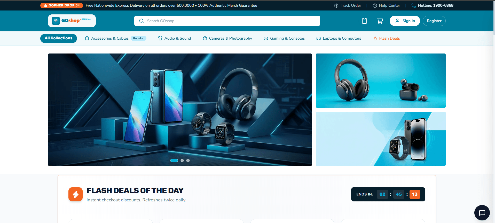
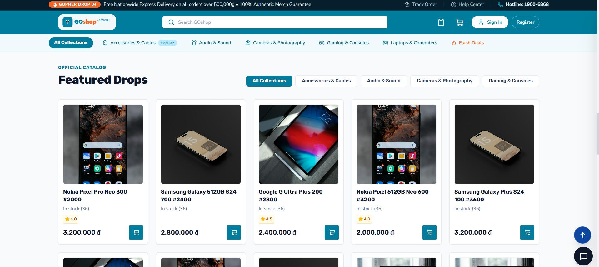
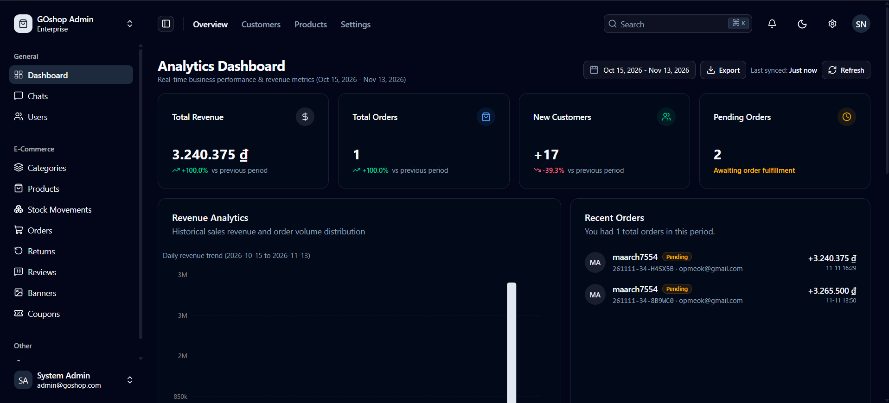
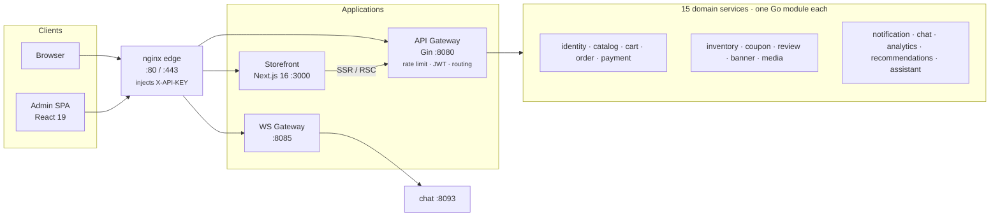
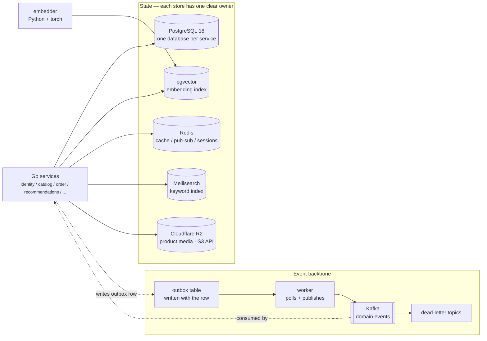

<div align="center">

# GOshop

**A production-shaped e-commerce platform, built in the open.**

Go microservices behind an API gateway · Next.js storefront · React admin dashboard
one edge proxy · one event bus · one PostgreSQL cluster per domain


[Architecture](#architecture) ·
[Environment setup](#environment-setup-read-this-before-anything-else) ·
[Running the stack](#running-the-stack) ·
[Scripts](#scripts) ·
[API docs](#api-documentation) ·
[Troubleshooting](#troubleshooting)

</div>

---

## Preview

| Storefront home page | Product catalogue | Admin dashboard |
|:---:|:---:|:---:|
| [](docs/img/storefront.png) | [](docs/img/storefront1.png) | [](docs/img/dashboard.png) |
| Next.js 16 storefront | Next.js 16 storefront | React 19 admin SPA |

---

## What this is

A storefront that sells, an admin dashboard that runs it, and a backend that stays correct
under load. Everything below is wired and runnable — not a scaffold:

| | |
|---|---|
| **15 Go services** | one module, one schema, one migration set each |
| **140 documented endpoints** | one OpenAPI spec, one generated TypeScript client |
| **Transactional outbox** | domain events committed with the row, never a dual write |
| **Hybrid search** | keyword + pgvector embeddings, fused with reciprocal rank fusion |
| **Full observability** | Prometheus, Grafana, Alertmanager, Promtail, k6 load tests |
| **Written down** | [`docs/ARCHITECTURE.md`](docs/ARCHITECTURE.md) traces checkout end to end; ten [ADRs](docs/ADR/README.md) record why, including what was rejected |

Built to be run for real: load shedding, circuit breakers, structured logs, health probes,
graceful shutdown, and an integration suite that runs against a real broker rather than mocks.

---

## Table of contents

- [Preview](#preview)
- [What this is](#what-this-is)
- [Tech Stack](#tech-stack)
- [Architecture](#architecture)
- [Repository Layout](#repository-layout)
- [Prerequisites](#prerequisites)
- [Environment Setup](#environment-setup-read-this-before-anything-else)
- [Running the stack](#running-the-stack)
- [Monitoring, tracing and logs](#monitoring-tracing-and-logs)
- [Demo accounts](#demo-accounts)
- [Scripts](#scripts)
- [API Documentation](#api-documentation)
- [Testing & CI](#testing-ci)
- [Troubleshooting](#troubleshooting)
- [Project status](#project-status)
- [License](#license)

---

## Tech Stack

### Backend


### Frontend


### Infra, Search & Observability


---

## Architecture

### Request path



### Data and events



**Design choices worth a look**

- **Domain-per-database** — each service owns its schema (15 Go modules, one schema each, plus
  a Python embedder sidecar). Migrations live beside the service that owns them. No service
  reads another's tables; cross-domain reads go through the gateway or an event.
- **Transactional outbox + Kafka** — domain events are written in the same transaction as
  the row change, then published by a background worker. No dual-write window, and a broker
  outage delays events instead of losing them.
- **Per-client refresh cookies** — the two frontends share an origin, so refresh tokens are
  scoped per client (`X-Client-App`) and rotated into the exact cookie they were read from.
  Access tokens stay in memory only.
- **Typed API boundary** — a single OpenAPI schema generates `@goshop/api-client`, consumed
  by both apps. Path drift between gateway and services is caught by
  `scripts/check-compose-parity.py` before the stack even starts.
- **R2 in prod, MinIO in dev** — uploads use presigned URLs against an S3-compatible bucket,
  so prod points at Cloudflare R2 (`STORAGE_DRIVER=r2`, no egress bill, no media container in
  the compose file) while dev keeps a throwaway MinIO behind the `minio` profile. Same code
  path, one env switch.
- **Retail-grade edges** — Go runtime caps (`GOMEMLIMIT`, `GOMAXPROCS`), circuit breaker
  (`gobreaker`), gzip, graceful shutdown, structured zerolog to stdout so Promtail ships
  every line to Loki (no log file to lose with the container).

---

## Repository Layout

```
backend/
  gomod/shared/           reusable packages (config, logger, telemetry, utils)
  gomod/contracts/        event payloads shared by services
  gomod/services/         one module per domain (identity, catalog, order, ...)
  gomod/cmd/              one binary per service
  build/Dockerfile.service  one image template, ARG SERVICE=<name>
frontend/
  apps/storefront/        Next.js 16 App Router
  apps/dashboard/         Vite + React 19 admin SPA
  packages/api-client/    generated OpenAPI client with silent refresh
nginx/                    edge config, API key templates, TLS
scripts/                  dev orchestration, secrets, smoke tests, load tests
system/                   Prometheus rules, Grafana, Alertmanager, Promtail, R2, Redis
design-system/goshop/     MASTER.md — tokens and layout rules the UI is built from
docker-compose.prod.yml   full stack (edge, gateway, 15 services, infra, observability)
docker-compose.dev.yml    containerised dev topology
docs/SERVICES.md          generated index: HTTP/gRPC ports, database, migrations per service
docs/ARCHITECTURE.md      checkout traced end to end, failure matrix, compensation flow
docs/ADR/                 ten accepted decisions with consequences and rejected alternatives
DEPLOY.md                 production deployment ADR (topology, secrets, rollback)
Makefile                  every workflow below
```

> Per-service detail: [`docs/SERVICES.md`](docs/SERVICES.md) is generated from compose and the
> migrations (`make services-doc`), so it cannot drift. Only `order` also has a hand-written
> [`README.md`](backend/gomod/services/order/README.md) covering ownership and failure modes.

---

## Prerequisites

| Tool | Version | Notes |
|---|---|---|
| Docker Desktop | 4.x+ | Linux containers; 8 GB RAM recommended |
| Go | 1.26+ | only needed for `make dev-host` / bare metal |
| Node.js | 22+ | storefront + dashboard |
| pnpm | 11.x | `corepack enable` is enough |
| GNU Make | any | Windows: `choco install make` or run commands by hand |
| PowerShell | 7+ | the `.ps1` orchestration scripts target it |

---

## Environment Setup (read this before anything else)

The repo ships **templates only** — every real `.env` is git-ignored because it holds
secrets. Nothing runs until you copy the templates and fill in the `CHANGE_ME` values.

There are **two variants** per side, and `make` swaps which one is active by copying it over
the filename the code actually reads.

```
backend/.env.example           →  backend/.env          (read at runtime by every service)
backend/.env.dev.example       →  backend/.env.dev      (dev variant, switched by make env-dev)
backend/.env.prod.example      →  backend/.env.prod     (prod variant, switched by make env-prod)

frontend/apps/storefront/.env.example       →  .env
frontend/apps/storefront/.env.dev.example   →  .env.dev
frontend/apps/storefront/.env.prod.example  →  .env.prod
frontend/apps/storefront/.env.dev-host      →  .env.local  (copied by `make dev-host`)
```

### Step 1 — Backend

```powershell
cd backend

# Pick ONE starting point.
Copy-Item .env.example     .env        # minimal, single-service
# or
Copy-Item .env.dev.example .env.dev    # full dev variant (recommended)
Copy-Item .env.prod.example .env.prod  # full prod variant (only if deploying)
```

Then open the file and replace **every** `CHANGE_ME`:

| Variable | What to put |
|---|---|
| `API_KEY` | any 32+ char random string (edge injects it as `X-API-KEY`) |
| `INTERNAL_API_SECRET` | another random string, service-to-service only |
| `DB_PASSWORD` | the password `postgres` container will use |
| `JWT_PRIVATE_KEY` / `JWT_PUBLIC_KEY` | paths to your RSA key pair, e.g. `certs/jwt_private.pem` |
| `APP_ORIGIN` | **one switch** — every browser URL derives from it (`http://localhost`) |

Generate the secrets in one shot rather than typing them by hand:

```powershell
# Rotates API_KEY into nginx/secrets/api_key + backend/.env, keeps the internal token stable
powershell -ExecutionPolicy Bypass -File ..\scripts\gen-local-secrets.ps1
```

> If you start from `.env.dev.example`, the active file is `backend/.env.dev`. Run
> `make env-dev` (from the repo root) to copy it over `backend/.env`. Same for prod with
> `make env-prod`. Compose always reads the literal path `backend/.env`, so a variant that is
> never copied over is never read.

JWT keys, if you need to make them:
```powershell
openssl genpkey -algorithm RSA -out certs/jwt_private.pem -pkeyopt rsa_keygen_bits:2048
openssl rsa -pubout -in certs/jwt_private.pem -out certs/jwt_public.pem
```

### Step 2 — Storefront

```powershell
cd frontend/apps/storefront

# dev-host topology (Go services on your host, gateway on :8080)
Copy-Item .env.dev-host .env.local

# bare containerised dev (edge on :80)
# Copy-Item .env.development .env.local

# or start from the template and fill it in
# Copy-Item .env.example .env.local
```

Order of precedence is `.env.local` → `.env.development` → `.env`. A **stale `.env.local`
pointing at the wrong port is the single most common "why is everything 502" cause** — delete
it when switching topologies, which is exactly what `make dev` / `make env-dev` do for you.

### Step 3 — Dashboard

The dashboard only needs the API base URL. `frontend/apps/dashboard/.env` already ships with:

```dotenv
VITE_API_BASE_URL=
VITE_API_KEY=
```

Both empty is correct: the SPA runs same-origin behind the edge, and the edge injects
`X-API-KEY`. In dev, Vite proxies `/api` to `DASHBOARD_PROXY_TARGET` (default
`http://localhost:8080`).

```powershell
cd frontend/apps/dashboard
$env:DASHBOARD_PROXY_TARGET="http://localhost"   # only if you are pointing at the edge on :80
pnpm dev
```

### Step 4 — Verify

```powershell
# from the repo root
make check-parity     # static: every gateway proxy target exists in the compose file
make smoke-dev        # live: probes each proxied route, fails on 502
```

---

## Running the stack

### Quick start

```powershell
make dev-host     # ~5–10 min first run: builds images, starts infra, runs Go services on the host
make smoke-dev    # confirms every route answers
```

Open **`http://127.0.0.1/`** (storefront) and **`http://127.0.0.1/admin/`** (dashboard).

> `http://localhost/` can hang on Windows because it resolves to IPv6 first while Docker
> publishes on IPv4. Use `127.0.0.1`, or map it in `hosts`.

### Choose a topology

| Goal | Command | What runs where | URL |
|---|---|---|---|
| Fastest loop, host-side Go | `make dev-host` | Infra in Docker, Go services on the host, gateway `:8080` | `http://localhost:5173/admin/`, storefront `:3001` |
| Everything containerised | `make dev` | Full dev compose + edge | `http://127.0.0.1/` |
| Production-shaped | `make prod` | Full prod compose behind nginx | `http://127.0.0.1/`, `:443` |
| Stop cleanly | `make stop-dev` / `make stop-prod` | Kills host binaries **and** containers | — |

### Local monitoring

`system/grafana/dashboards/goshop-overview.json` is provisioned by a `grafana` container in
`docker-compose.dev.yml`, so the committed dashboard has a Prometheus to read without a
Grafana Cloud account:

```powershell
docker compose -f docker-compose.dev.yml --env-file backend/.env up -d grafana
```

| Surface | URL |
|---|---|
| Dashboard "GOshop Overview" | `http://127.0.0.1:3001/d/goshop-overview` |
| Grafana (anonymous, viewer) | `http://127.0.0.1:3001` |
| Prometheus | `http://127.0.0.1:9090` |
| Alertmanager | `http://127.0.0.1:9093` |
| Jaeger (traces, dev only) | `http://127.0.0.1:16686` |

The dashboard is read-only on purpose: edit the JSON in git, then restart the container.
Production does not run this container — dashboards there live in Grafana Cloud, which reads
the same `prometheus.yml` scrape config.

---

## Monitoring, tracing and logs

Three signals, one question each: **is it up** (metrics), **why was this request slow or
broken** (traces), **what exactly happened** (logs). The fourth question — *is a message stuck* —
is answered by Kafka lag, which is a metric with an alert on it.

### 1. Metrics — Prometheus + the dashboard

Every service mounts `GET /metrics` on its own gin router (`shared/pkg/metrics`). Prometheus
discovers containers by name (`system/prometheus/prometheus.yml`), so nothing is registered by
hand. `kafka-exporter` adds broker-side metrics that no Go process can see:
`kafka_consumergroup_lag`, under-replicated partitions, throughput.

```powershell
# raw scrape targets and their state
start http://127.0.0.1:9090/targets

# a quick ad-hoc query
start "http://127.0.0.1:9090/graph?g0.expr=sum%20by%20(consumergroup)%20(kafka_consumergroup_lag)"
```

What the 6 dashboard panels tell you:

| Panel | Reads | Red flag |
|---|---|---|
| Services Up / Down | `up{job="goshop-services"}` | Down > 0 for 2 min → `ServiceDown` (critical) |
| Consumer Lag by Group | `kafka_consumergroup_lag` | > 1000 for 5 min → `ConsumerLagHigh`; flat and non-zero → `ConsumerLagStalled` |
| Publish OK vs Errors | `kafka_publish_ok_total`, `kafka_publish_errors_total` | > 0.2 errors/s for 10 min → `KafkaPublishFailing` |
| DLQ Moves | `kafka_dlq_total` | Any rate → `KafkaDLQGrowing`, drain with `make check-dlq` |
| Records Missing `event_id` | `kafka_records_published_total` vs `..._missing_event_id_total` | > 1% → `EventsMissingEventID`; those records cannot be deduplicated |

Per-service counters worth knowing: `kafka_publish_ok_total`, `kafka_publish_errors_total`,
`kafka_dlq_total`, `kafka_consume_errors_total`, `kafka_records_published_total`,
`kafka_records_missing_event_id_total`.

`/metrics` is **unauthenticated and internal only**. It is not published in prod and nginx does
not proxy it — do not add a rule for it.

Alert thresholds live in `system/prometheus/rules/goshop.yml`; `scripts/check_alert_rules.py`
fails CI if a rule references a metric nobody exposes. Discord delivery needs
`ALERTMANAGER_DISCORD_WEBHOOK_URL`; with it empty, dev starts with a silent config and alerts
fire but go nowhere.

### 2. Traces — Jaeger in dev, Grafana Cloud Tempo in prod

Tracing is **off unless an endpoint is configured** (`shared/pkg/telemetry`): with no
`OTEL_EXPORTER_OTLP_ENDPOINT` the provider is a no-op and the service still serves traffic.

- **Dev**: start the collector with the rest of the stack —
  `docker compose -f docker-compose.dev.yml --env-file backend/.env up -d jaeger`, then open
  `http://127.0.0.1:16686`, pick a service (`goshop-order`, `goshop-payment`, …), search.
- **Prod**: set `OTEL_EXPORTER_OTLP_ENDPOINT` + `OTEL_EXPORTER_OTLP_HEADERS` to a Grafana Cloud
  OTLP gateway; sampling is `OTEL_TRACES_SAMPLER_ARG` (`0.1` in the prod example).

> **`backend/.env` wins over the compose default.** Services are given
> `OTEL_EXPORTER_OTLP_ENDPOINT=${OTEL_EXPORTER_OTLP_ENDPOINT:-http://jaeger:4318}`, so a value in
> `backend/.env` overrides it. With the Grafana Cloud line in place, containers send spans to
> Tempo and `http://127.0.0.1:16686` stays empty. Check what a process actually got, and
> re-create it once after switching:
>
> ```powershell
> docker exec goshop-order printenv OTEL_EXPORTER_OTLP_ENDPOINT
> docker compose -f docker-compose.dev.yml --env-file backend/.env up -d --force-recreate order payment
> ```

A trace spans HTTP → gRPC → Kafka because the W3C `traceparent` is extracted by
`middleware.TraceMiddleware()` and re-injected into Kafka record headers
(`shared/pkg/kafka/trace.go`). `payment.settle` is an explicit child span, so a webhook can be
followed from the provider IPN to the settlement transaction.

Trace boundaries, so you know what to expect in the UI:

| Span kind | Created by | Continues the same trace? |
|---|---|---|
| HTTP server span (one per request) | `middleware.TraceMiddleware()` | yes, extracts incoming `X-Trace-Id` |
| gRPC server span (one per call) | `shared/pkg/telemetry.UnaryServerInterceptor()` | yes, extracts metadata |
| gRPC client | interceptor injects only — **no client span** | parent link preserved, no extra box |
| Kafka producer | `injectTraceContext` header only — **no span** | header carries the id; see below |
| Kafka consumer | **not extracted** (`kafka/retry.go`) | no. The event keeps the producer's `trace_id` as a *log field*, and a consumer that does work starts a new trace |

That last row is a deliberate limit: an async consumer is a new unit of work, and stitching it
into the request trace needs a span link, which is not implemented here. In practice you follow
a checkout through Jaeger (sync part) and through `trace_id` in the logs (async part).

### 3. Logs — one JSON line per event, shipped to Loki

Services log with zerolog, always to **stdout** — Promtail tails the Docker log file, so
nothing is written to a container-local file that dies with the container.

Every request line carries `trace_id` (`middleware.StructuredAccessLog`):

```json
{"level":"info","time":"...","trace_id":"4bf92f3577b34da6...","method":"POST","path":"/api/v1/orders","status_code":201,"duration_ms":84,"message":"HTTP request"}
```

That key is the join between all three signals: response header `X-Trace-Id` → Loki log line
→ Jaeger trace.

```powershell
# container stdout, no Loki needed
docker logs goshop-order --since 10m | Select-String "level.:.error"
docker logs goshop-api1 --since 5m

# through Promtail, from any machine with the Grafana Cloud keys in backend/.env
make logq Q='{container=goshop-order} |= "error"' HOURS=6
make logq Q='{service=~api1|api2} | json | status_code >= 500' HOURS=1 LIMIT=50
```

Loki labels: `level` and `service`/`container` are indexed; `trace_id` is structured metadata
(not a label) so it stays cheap. To go from a log line to evidence, take its `trace_id` and
open `http://127.0.0.1:16686/trace/<trace_id>`.

### 4. Health and lag without Prometheus

Each service answers two probes; `kafka.RegisterHealthz` layers consumer lag on top:

```powershell
curl.exe -s http://127.0.0.1:8088/healthz/live     # process alive, never touches a dependency
curl.exe -s http://127.0.0.1:8088/healthz/ready    # Postgres + Kafka, 2s timeout
curl.exe -s http://127.0.0.1:8092/healthz          # analytics: includes messaging_lag per group
```

`messaging_lag` above the same 1000-message threshold used by `ConsumerLagHigh` flips the
response to `503 degraded`, so the probe and the alert agree on what "stuck" means.

### 5. Trace one request, step by step

The whole loop is: **read `X-Trace-Id` off a response → open that trace → find the same id in the
logs → confirm the consequence in a metric**. Example with a checkout, but the pattern is the
same for any route.

**Step 1 — send one request and keep its trace id.**

```powershell
$r = Invoke-WebRequest -Uri "http://127.0.0.1:8092/healthz" -UseBasicParsing
$trace = $r.Headers["X-Trace-Id"]
$trace
```

Any HTTP surface answers with `X-Trace-Id`; every service sets it in `TraceMiddleware`. With the
gateway in dev (`http://127.0.0.1:8080/api/v1/...`) the same header comes back on the edge too
(the browser devtools Network tab shows it if you prefer clicking).

**Step 2 — open the trace.** `http://127.0.0.1:16686/trace/<trace>` (or pasting the id into
Jaeger's *Search by Trace ID*). You should see the HTTP server span named after the gin route
(`/healthz`), and — for a checkout — child `goshop/grpc` spans for catalog, inventory, coupon and
cart.

**Step 3 — find the same id in the logs.** The id is on every `HTTP request` line
(`middleware.StructuredAccessLog`):

```powershell
docker logs goshop-order --since 10m | Select-String $trace
make logq Q="{container=goshop-order} |= `"$trace`"" HOURS=1
```

The second form goes through Promtail → Grafana Cloud Loki, so it works for a container that has
already been recreated (the `docker logs` form does not). Inside Grafana Cloud Explore, the same
query is `{container="goshop-order"} |= "<trace>"`.

**Step 4 — follow the async half.** The order publishes `order.created`; analytics consumes it. The
consumer does **not** continue the trace (see the table above), so follow the *field* instead:

```powershell
make logq Q="{container=goshop-analytics} |= `"$trace`"" HOURS=1
```

If the event was produced inside the request, the Kafka header carries the same `trace_id`
(`shared/pkg/kafka/broker.go:183`), so a hit in the analytics logs proves the event that came
out of *that* checkout was processed — and a miss, with the projection unchanged, is a
consumer/DLQ problem rather than a checkout problem.

**Step 5 — confirm in metrics.**

```powershell
make check-dlq                                   # nothing stuck in a DLQ topic
start http://127.0.0.1:3001/d/goshop-overview    # order count / revenue move one event later
start http://127.0.0.1:9090/targets              # every goshop-* target UP
```

**When the trace is missing**, in this order:

1. `docker exec goshop-order printenv OTEL_EXPORTER_OTLP_ENDPOINT` — empty or pointed at Grafana
   Cloud? The compose default `http://jaeger:4318` was overridden by `backend/.env`.
2. `docker logs goshop-jaeger | Select-String "trace"` — nothing arriving means the service was
   started before Jaeger and its exporter is backing off.
3. Sampling: `OTEL_TRACES_SAMPLER_ARG=0.1` drops 9 of 10 traces by design. In dev, unset it (or
   set `1`) before hunting a specific request.
4. The span is there but no `X-Trace-Id`: the request never reached a service that mounts
   `TraceMiddleware` — check the edge (nginx returns its own 404 with no trace header).

### Operationally, each piece costs this much

| Piece | Keeps | Needs |
|---|---|---|
| Prometheus | 7 days in `prometheus-data` | ~200 MB RAM, docker socket (read-only) |
| Grafana | dashboard state in `grafana-data` | ~150 MB RAM, dev only |
| Jaeger | nothing (in-memory), dev only | ~100 MB RAM |
| Promtail | positions in `/tmp` | ~40 MB RAM + Grafana Cloud keys |
| Alertmanager | silences in `alertmanager-data` | ~20 MB RAM + a Discord webhook |

Remove `grafana` from the compose file and the stack still runs: the dashboard is a
convenience, not a dependency.

> Port clash: `grafana` binds host `:3001`, which `make dev-host` also uses for the storefront.
> Pick one — run the dashboard with `make dev`, or change the published port in
> `docker-compose.dev.yml`.

### Seed data

```powershell
make seed          # host Postgres
make seed-docker   # through the postgres container
```

One seed run populates every database:

| Database | Contents |
|---|---|
| `shopping_identity` | 51 users (4 staff + 47 customers), addresses |
| `shopping_catalog` | 8 categories, 5000 products with curated photography, search outbox rows |
| `shopping_coupon` | Coupons across fixed/percentage and expiry states |
| `shopping_inventory` | Stock rows + movement history per product |
| `shopping_order` | 100 orders spanning every status, 200 items, tracking events, 14 return tickets |
| `shopping_payment` | VNPay/MoMo transactions for the online orders, refund legs |
| `shopping_analytics` | Order projections rebuilt from `shopping_order` so the dashboard has KPIs immediately |

Order rules the seed enforces, so the demo screens look like a real shop:

- **Pending orders are always cash-on-delivery.** An online order never sits in `pending` —
  it is `paid`, `failed`, `expired`, `refunded`, or `partially refunded`. This mirrors the
  payment flow: a gateway transaction resolves before the order can be considered placed.
- `total_amount = subtotal − discount + shipping_fee` holds on every row.
- Timestamps are spread over the last ~400 days so the revenue chart, growth deltas and
  "last 30 days vs previous 30" comparisons all have movement.

The analytics service normally fills its projection tables from Kafka `order.*` events. The
seed writes SQL directly and emits no events, so its last section rebuilds the projections
from `shopping_order` (same columns the projection consumer upserts).

---

## Demo accounts

Every seeded account uses the same password. They are development credentials — the seed is
never run against production data.

| Email | Password | Role | Sees |
|---|---|---|---|
| `admin@goshop.com` | `Admin123!` | Admin (`user_level` 1) | everything: analytics, catalog, orders, users, settings |
| `manager@goshop.com` | `Password123!` | Staff (`user_level` 2) | catalog, orders, inventory, reports |
| `mod@goshop.com` | `Password123!` | Staff (`user_level` 2) | reviews, banners, content |
| `admin@gmail.com` | `Password123!` | Admin (`user_level` 1) | second admin, used by the storefront demo |

Customers are `user1@goshop.com` … `user7@goshop.com` and `customer12@testmail.com` …
`customer51@testmail.com` — 47 storefront accounts, all `Password123!` (`user_level` 3).

> Two rate limiters guard login (edge middleware and the auth service). Hammering the login
> form during a demo returns **429**; clear the counters:
>
> ```powershell
> docker exec goshop-redis redis-cli --scan --pattern "*ratelimit*" |
>   ForEach-Object { docker exec goshop-redis redis-cli DEL $_ | Out-Null }
> ```

---

## Scripts

### Make targets (repo root)

| Command | What it does | Topology |
|---|---|---|
| `make dev` | Full containerised stack via `docker-compose.dev.yml` + edge on `:80` | all-in-Docker |
| `make dev-host` | Infra in Docker, Go services built and run on the host; gateway on `:8080` | hybrid (fastest loop) |
| `make stop-dev` | Stops the dev stack **and** host binaries (prevents "address already in use") | — |
| `make env-dev` / `make env-prod` | Copies the variant env files over the active ones | — |
| `make prod` | Full `docker-compose.prod.yml` stack behind nginx on `:80/:443` | production |
| `make stop-prod` | Stops the prod stack | — |
| `make build` | Builds every Go binary into `backend/bin` | — |
| `make sqlc` | Regenerates type-safe query code for all services | — |
| `make swagger` | Regenerates the OpenAPI spec (`/swagger` on the gateway) | — |
| `make swagger-check` | Fails when the committed spec drifted from the code (CI gate) | — |
| `make migrate-up` / `migrate-down NAME=...` | Migrations for every service (`migrate-<service>-up` for one) | — |
| `make seed` / `make seed-docker` | Seeds demo catalog, users, orders | — |
| `make smoke-dev` / `make smoke-prod` | Probes every gateway route; any 502 fails the run | — |
| `make check-parity` | Static check of gateway proxy targets against compose (~2 s, no Docker needed) | — |
| `make services-doc` | Regenerates `docs/SERVICES.md` from compose, migrations and proto contracts | — |
| `make loadtest` / `stresstest` / `spiketest` | k6 scenarios against the edge | — |
| `make test-kafka-integration` | Outbox/consumer suite against a real Kafka in Testcontainers | — |
| `make kafka-env` | Merges generated Kafka SASL/TLS values into `backend/.env` (add `ROTATE=1` to rotate) | — |
| `make importdb` / `make exportdb` | Database dump / restore | — |

### PowerShell scripts (`scripts/`)

| Script | Purpose |
|---|---|
| `dev.ps1` | The engine behind `make dev-host`: builds domain images, runs Go services on the host, waits for health |
| `stop-dev.ps1` | Kills host binaries and containers left behind by a dev run |
| `gen-local-secrets.ps1` | Generates/rotates `API_KEY` (writes `nginx/secrets/api_key` + `backend/.env`); `-RotateInternalToken` to rotate the internal token |
| `gen-kafka-env.ps1` | Generates SASL credentials + TLS material and merges them into `backend/.env` (`-Rotate`) |
| `gen-kafka-tls-certs.ps1` | Issues the broker CA and certificates |
| `smoke-dev.ps1` / `smoke-prod.sh` | Route-by-route live probe; non-zero exit on the first 502 |
| `check-compose-parity.py` | Compares the gateway's proxy table to compose; catches a service that exists in prod but not dev |
| `patch-openapi-spec.py` | Merges the service-owned routes into the gateway spec; `--from <fresh>` keeps them when `swag` only sees the gateway |
| `check-dlq.ps1` / `clear-dlq.ps1` | Inspect / drain Kafka dead-letter topics |
| `check-kafka-health.ps1` | Broker, consumer group lag, topic sanity |
| `kafka-acls.sh` / `kafka-sasl-users.sh` | Provision SCRAM users and per-topic ACLs |
| `reindex-product-images.ps1` | Re-uploads media and rebuilds derived image paths |
| `recommendation-acceptance.ps1` | End-to-end check of the vector-search recommendation path |
| `verify_lag_alert.py` / `check_alert_rules.py` | Asserts the Prometheus alert rules fire at the expected thresholds |

### Frontend

```powershell
cd frontend
corepack enable
pnpm install

pnpm dev:dashboard      # http://localhost:5173/admin/
pnpm dev:storefront     # http://localhost:3001
pnpm build              # turbo: every app
pnpm lint
pnpm gen:api            # regenerate @goshop/api-client from the OpenAPI schema
```

---

## API Documentation

The gateway serves the spec at **`/swagger/index.html`** (Swagger UI) and the raw document at
`backend/gomod/shared/docs/`:

```
swagger.json    Swagger 2.0 source of truth
swagger.yaml    same document, YAML
docs.go         the same spec compiled in; the gateway serves it at runtime
openapi.json    OpenAPI 3.0 conversion (what frontend/packages/api-client is generated from)
```

Regenerate after adding or changing a route:

```powershell
make swagger        # rewrite all four files
make swagger-check  # CI gate: fails when the committed spec drifted
```

**Why the target is not just `swag init`.** The backend is a Go workspace with one module per
service, and `swag` cannot parse across module boundaries: pointed at the gateway alone it
returns 3 paths and silently deletes the other 137; given more than one module it dies on
`cannot find type definition: utils.APIResponse`. So `make swagger` regenerates **only the
gateway's own routes** into a scratch directory and `scripts/patch-openapi-spec.py` merges them
into the committed spec, re-asserting the routes that live in service modules
(recommendations, assistant, hybrid search) from definitions kept in that script.

The consequence is concrete: a new route annotated inside `gomod/services/*` does **not** appear
in the spec until it is added to `patch-openapi-spec.py`. `make swagger-check` catches drift
between the script and the committed spec, not a route the script does not know about.

---

## Testing & CI

```
.github/workflows/backend-ci.yml    buf lint + breaking check, gofmt, go vet, race tests per module,
                                    golangci-lint, compose config smoke check
.github/workflows/frontend-ci.yml   dashboard build + Vitest + lint, storefront build,
                                    assert no API key leaked into bundles
```

Locally:

```powershell
# backend — the workspace root is not a module, so this must run per module
cd backend
foreach ($m in "shared","contracts","cmd","services") { (cd "gomod/$m"; go test ./...); cd ../.. }

# dashboard
cd frontend/apps/dashboard; npx tsc -b; npx vitest run --browser.headless

# storefront
cd frontend/apps/storefront; npx tsc --noEmit; npx vitest run
```

`make test-kafka-integration` is the one that matters for the event pipeline — it runs the
real outbox publisher against a real broker.

---

## Troubleshooting

| Symptom | Cause | Fix |
|---|---|---|
| Every API call returns **502** | Vite proxy target has nothing listening (usually `:8080` is dark because only the prod stack is up) | `make dev-host`, or point the dashboard at the edge: `$env:DASHBOARD_PROXY_TARGET="http://localhost"` |
| `bind: address already in use` | Host binaries from a previous run still alive | `make stop-dev` |
| Browser hits a closed port after switching topology | Stale `frontend/apps/storefront/.env.local` | delete it; `make env-dev` / `make dev` do this for you |
| `unknown port` / service crashes at boot | A stray character in `backend/.env` (a trailing backtick is the classic) | re-check the line, or recreate from the `.example` |
| Google login `ERR_CONNECTION_REFUSED` | Storefront pointing at `:80` while no edge is running | use `.env.dev-host` (targets `:8080`) |
| 502 only on one feature (`/ws`, analytics, media) | Service exists in prod compose but not dev | `make check-parity`, then `make smoke-dev` |
| Login returns **429** after a few attempts | Two login rate limiters (edge Redis + auth service) counted the same IP | clear `*ratelimit*` keys in Redis (snippet in [Demo accounts](#demo-accounts)) |
| Analytics dashboard shows 2 orders after a seed | Dashboard reads `shopping_analytics` projections, and the seed emits no Kafka events | re-run the seed — its last section rebuilds both projections |
| Product images blank | A seed older than the curated-photo change still points at `picsum.photos` | re-run `make seed`; every product now uses one of 32 curated Unsplash shots |

---

## Project status

Actively developed. What is done and what is deliberately not:

| | |
|---|---|
| **Working end to end** | storefront browse/cart/checkout, admin CRUD, auth with silent refresh, hybrid search, recommendations, assistant |
| **Tested** | unit + race tests per Go module in CI, Vitest for both frontends, k6 load scenarios, `make smoke-dev` route probe |
| **Known gap** | the OpenAPI spec cannot be regenerated in one pass (see [API Documentation](#api-documentation)); service-owned routes are declared in `scripts/patch-openapi-spec.py` |
| **Not included** | hosted demo, `LICENSE` file, `CONTRIBUTING.md`, `SECURITY.md` |

---

## License

MIT
