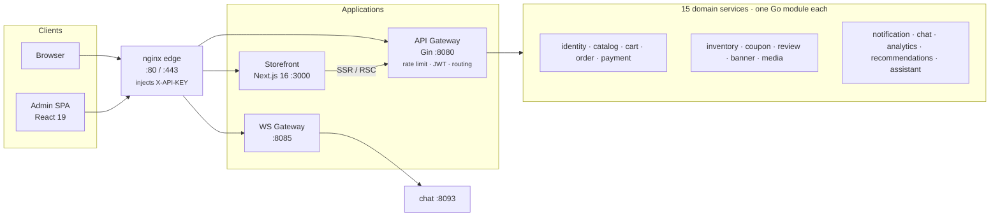
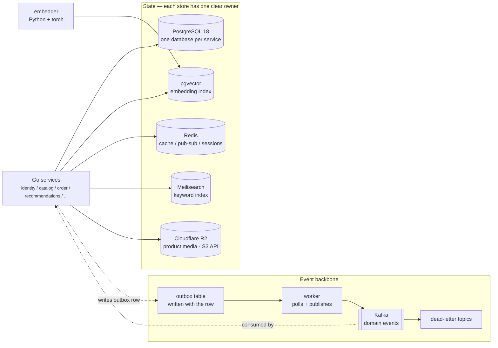
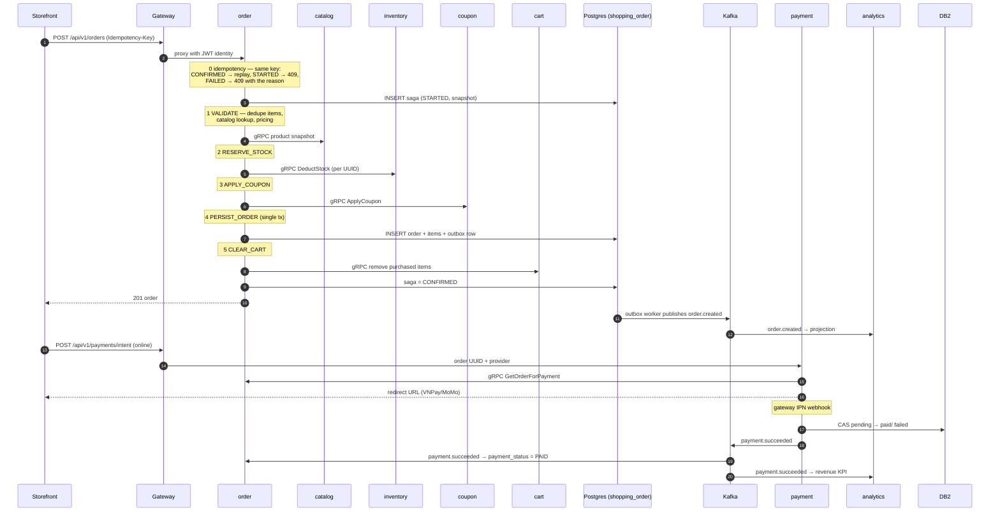
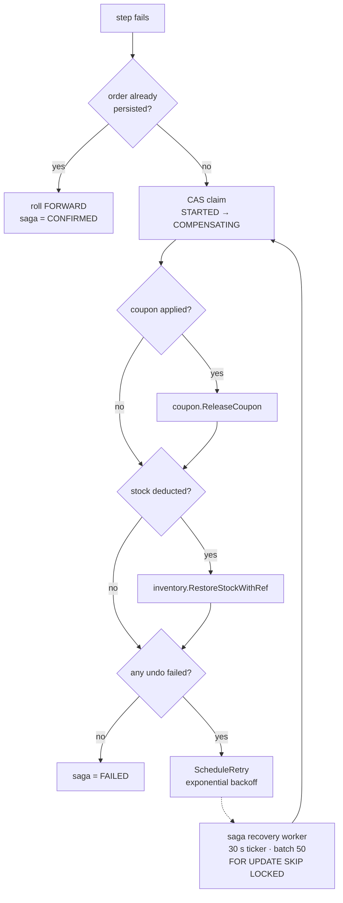

# Checkout, end to end

> How a cart becomes an order, a payment, a stock deduction and a dashboard number —
> across five services, two datastores and one event bus. Every step below is wired in
> this repo; the file names are there so you can read the real code.

The interesting part of GOshop is not any single service. It is that a checkout has to
stay correct when four of them fail mid-flight, and that no service ever writes another
service's tables.

---

## The topology

---

## Checkout in nine steps

`POST /api/v1/orders` (storefront → gateway → order service). Everything from step 2 on is
inside the **order saga**, a state machine checkpointed to Postgres after every step.

### Steps 1–7 — the checkout saga

| # | Saga step | What happens |
|---|---|---|
| 1 | Request → `POST /api/v1/orders` | The gateway forwards the JWT subject; order resolves the customer over gRPC. A repeat with the same `Idempotency-Key` never starts a second saga: `CONFIRMED` replays the order, `STARTED` returns `409 in progress`, `FAILED`/`COMPENSATING` returns `409` with the stored reason (`ExecuteCheckoutSaga`). |
| 2 | Saga row created first | `order_sagas` row with `state = STARTED` and an empty snapshot, before any side effect. If the process dies later, the recovery worker finds it. |
| 3 | `VALIDATE` | Duplicate product UUIDs, catalog availability and pricing. Rejecting here costs nothing to undo. |
| 4 | `RESERVE_STOCK` | `inventory.ReserveStock` → `LockAndDeductStockWithRef` — deducts per product UUID and records a movement with `ref_type = "order"` and the order UUID, as one locked operation. |
| 5 | `APPLY_COUPON` | `coupon.ApplyCoupon` → `LockAndApplyCoupon` — claims usage against the order UUID. Compensation releases usage instead of recomputing a discount. |
| 6 | `PERSIST_ORDER` | One local transaction: order, items, tracking row and the **outbox event**. No window where an order exists without its `order.created`, or the reverse. |
| 7 | `CLEAR_CART` → `CONFIRMED` | `cart.RemovePurchasedItems` runs last because an empty cart is not recoverable. A `CONFIRMED` saga is never compensated (`CompensateSaga` returns early). |

### 8. Payment is a separate lifecycle, not part of the saga

Cash on delivery skips this entirely. For online payment the storefront asks the payment
service for an intent, which reads the amount through `order.GetOrderForPayment` (gRPC) and
converts to minor units once (`money.FromWholeDong`) so no downstream arithmetic touches
whole dong. The money itself moves at the provider, and the provider calls back:

- IPN webhook → `finalizeSettlement` flips the transaction with a **compare-and-set**
  (`AllowedFromStatuses: [PENDING]`), so a replayed webhook cannot double-apply.
- Then the event is written to the payment **outbox** in the same transaction as the status
  change, and published as `payment.succeeded` / `payment.failed`.
- `ReconcilePendingPayments` runs every 2 minutes (`payment/app/app.go`): for pending
  transactions older than 15 minutes it **asks the provider first**, and only expires them if
  the provider says the money was not taken. Expiring first would silently lose paid orders
  whose IPN got lost.

Order consumes `payment.succeeded` and flips its own `payment_status`; it does not trust the
webhook directly.

### 9. Analytics reads events, never order tables

Analytics owns `shopping_analytics` with two projection tables. A Kafka consumer dispatches
by routing key (`app.go`, `dispatchAnalyticsEvent`), applies each event at most once through
the Postgres `processed_events` ledger (survives restarts, unlike the old 24h Redis TTL),
and upserts the projection. The dashboard then queries projections only.

That is also why a fresh `make seed` must rebuild the projections by hand: the seed writes
SQL and emits no Kafka events, so nothing would feed the consumer.

---

## Compensation: what gets rolled back, and in what order

Any failure before `PERSIST_ORDER` triggers `CompensateSaga`, which walks the snapshot
backwards. Order is fixed: coupon release → stock restore → terminal state.

Two details that matter:

- **Roll forward beats roll back.** If the order row is already in Postgres, the saga goes
  to `CONFIRMED` even though a later step failed. A customer who has an order must not have
  it silently deleted by a failed cart clear.
- **Recovery is a real worker, not a log line.** `saga_recovery_worker.go` claims stale and
  retry-due sagas with `FOR UPDATE SKIP LOCKED`, so multiple order replicas never compensate
  the same order twice.

---

## Event ownership

| Event | Producer | Consumers | Owner of the side effect |
|---|---|---|---|
| `order.created` | order | analytics, notification, inventory | order |
| `order.status_changed` / `shipped` / `delivered` | order | analytics, notification | order |
| `order.cancelled` | order | inventory (restock), coupon (release), analytics | order |
| `payment.succeeded` / `failed` / `expired` | payment | order (payment status), analytics (revenue), notification | payment |
| `order_return.*` | order | inventory (restock), notification, analytics | order |
| `inventory.stock_low` | inventory | notification | inventory |
| `user.*` | identity | chat, notification, order | identity |

Routing keys are declared once in
[`contracts/events/events.go`](../backend/gomod/contracts/events/events.go). Each service's
consumer dispatches by key; consumers dedupe on `event_id` plus a business key.

---

## Failure matrix

| Failure | What happens | Why it is safe |
|---|---|---|
| Catalog down during `VALIDATE` | 5xx to the caller, saga fails at step 1 | Nothing was reserved yet |
| Inventory down during `RESERVE_STOCK` | saga → `COMPENSATING`, coupon released, stock restored | gRPC has a bounded deadline + circuit breaker |
| Order crashed after reserving stock | recovery worker compensates on the next tick | saga snapshot records the deducted items |
| Crash after `PERSIST_ORDER`, before `CLEAR_CART` | recovery worker rolls forward to `CONFIRMED` | an existing order is never rolled back |
| Payment IPN lost | `ReconcilePendingPayments` queries the provider, then expires only if unpaid | never expires money that was actually taken |
| Payment IPN replayed | CAS on `PENDING → PAID` fails the second time | provider transaction id is the business key |
| Duplicate `POST /orders` | same `Idempotency-Key` → replay, `409 in progress`, or `409` + reason; never a second saga | the saga row is the dedupe key |
| Kafka down | outbox rows stay `PENDING` and are retried by the worker | no dual write, no lost event |
| Duplicate event delivery | analytics `processed_events` ledger, inventory business key, payment idempotency key | at-least-once delivery becomes exactly-once effect |

---

## What this design deliberately does not do

| Not done | Why |
|---|---|
| Two-phase commit across services | Operational cost far beyond the learning goal; the outbox already gives safe retries |
| Orchestrated payment inside the checkout saga | Payment resolves later and out of band; coupling it would hold a DB transaction open across a human redirect |
| Direct cross-service SQL reads | Schema changes would break unrelated services; every read goes through gRPC, the gateway, or an event |
| Distributed tracing backend | `trace_id` is propagated through HTTP headers and event envelopes; Jaeger belongs in a later hardening phase |
| Full retry framework | Mutating calls must be idempotent first; the circuit breaker plus bounded deadlines cover the rest |

---

---

## Why some services have no gRPC, or no database

`docs/SERVICES.md` shows a dash in the gRPC or Database column for several services. Both are
decisions, not gaps. The rule behind them: **a boundary gets the minimum mechanism it needs.**

### gRPC is for the request path, not for symmetry

A service gets a proto when another service must ask it a question *inside* a transaction and
needs a typed, deadline-bounded answer:

| Service | Why gRPC |
|---|---|
| `identity` | order resolves the customer mid-checkout |
| `catalog` | checkout needs a price and availability snapshot |
| `inventory` | stock deduction is a locked operation that can fail the order |
| `coupon` | coupon usage must be claimed atomically with the order |
| `cart` | purchased items must be removed, and `ClearCart` must be callable |
| `payment` | reads the amount via `GetOrderForPayment` before charging |
| `order` | payment and review read order state; `VerifyPurchase` gates reviews |
| `chat` | ws-gateway proxies messages and needs a typed call per frame |

Everything else — `banner`, `notification`, `review`, `analytics`, `recommendations`,
`assistant`, `media` — is reached over HTTP through the gateway, or fed by Kafka events, or
both. None of them is called mid-transaction. Adding a proto would buy a second contract
surface (`.proto` + generated stubs + a versioning policy) for callers that already have an
HTTP client.

`recommendations` is the clearest case: it owns seven migrations' worth of state, but its
output is a *composed shelf* — a ranked page assembled from products, embeddings and view
history — not an entity another service would join against. HTTP returns that page; a proto
would just wrap the same JSON.

### A missing database column means a different store, not no state

| Service | State it owns | Why not Postgres |
|---|---|---|
| `assistant` | conversation sessions, per-user daily quota | both expire on their own; Redis TTL is the feature, not a workaround |
| `media` | uploaded bytes | the bytes live in object storage (R2/MinIO); the service is a presigner and a validator, and keeps no rows |

Both would need a migration set, a backup policy and a cleanup job to hold data whose entire
lifecycle is "expires in N hours". Redis expiry and bucket lifecycle rules already do that.

`banner` and `notification` do have a database but no proto: they are written by admin HTTP
calls and read by consumers, so there is no synchronous caller to serve. `analytics` is
event-fed and HTTP-read for the same reason.

### What the rule costs

- A new synchronous dependency must ship a proto and honour its versioning — a deliberate
  speed bump before coupling two services on the request path.
- HTTP-only services rely on the gateway for auth and rate limiting, so testing them in
  isolation means testing through the edge (or with `make smoke-dev`).

---

## Where to read the code

| Step | File |
|---|---|
| Saga steps, snapshots, compensation | `backend/gomod/services/order/internal/service/order_saga_orchestrator.go` |
| Checkout HTTP entry | `backend/gomod/services/order/internal/service/order_checkout_service.go` |
| Recovery worker | `backend/gomod/services/order/internal/worker/saga_recovery_worker.go` |
| Payment intent + reconcile | `backend/gomod/services/payment/internal/service/payment_service.go` |
| IPN webhook + CAS settlement | `backend/gomod/services/payment/internal/service/payment_webhook.go` |
| Projection consumer + dispatch | `backend/gomod/services/analytics/internal/worker/order_projection_consumer.go`, `app/app.go` |
| Routing keys / event payloads | `backend/gomod/contracts/events/events.go` |
| gRPC contracts | `backend/gomod/shared/proto/{order,payment,inventory,coupon,cart}/v1` |
